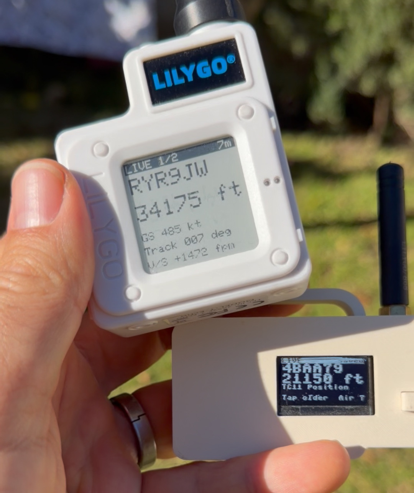
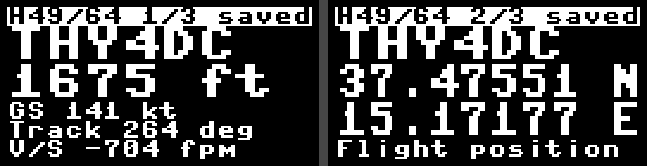
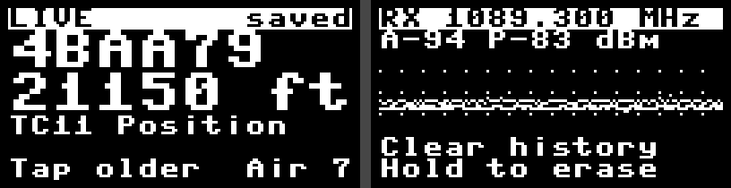
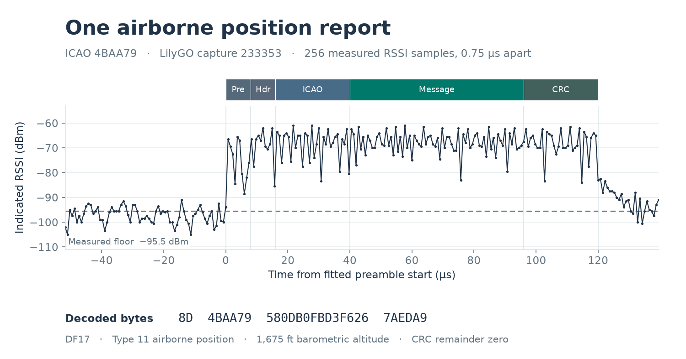
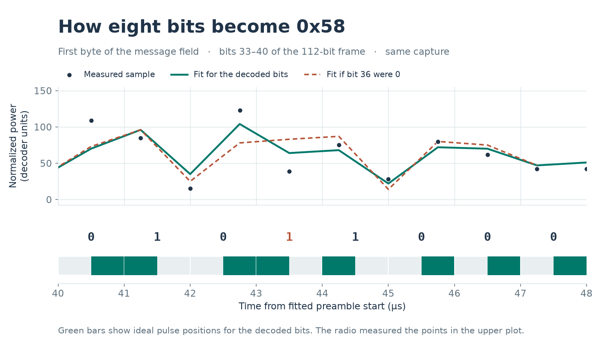
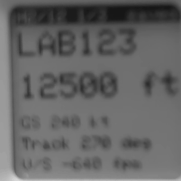

# ADS-B on the LilyGO T3-S3 and T-Echo

Tired of waiting for LoRa messages? You are in the right place: this firmware turns the **LilyGO T3-S3** with an OLED and the **original LilyGO T-Echo** with an e-paper display into pocket aircraft receivers. Both use an unmodified SX1262 radio (no hardware modifications needed). Connect an antenna to the LoRa antenna connector (even the stock antenna works) and power the board by USB or battery. It listens on 1090 MHz for the ADS-B messages in which aircraft broadcast their identity, position and movement. The display shows the flight's callsign or the aircraft's six-character address in large type. As reports arrive, the board fills in altitude, speed, direction and coordinates. The sampler, decoder and flight display logic are written in C. You can retrieve the recordings over USB after an outing. Note: **the technical details used in order to turn the SX1262 into an ADSB receiver are quite interesting, check them later**.



The T-Echo shows **RYR9JW at 34,175 ft**. Beside it, the T3-S3 shows a position report from **4BAA79 at 21,150 ft**. The camera caught only a few lit OLED rows in each video frame, so we combined rows from neighboring frames to make the screen readable.





These are screenshots from the board. The upper pair shows the same packet three seconds apart as the flight details rotate. Below are the live view and the settings menu. [How to read the display](#reading-the-display)

1090 MHz is outside the SX1262's specified 150–960 MHz range. The radio can tune there on the tested board, but the board's RF front end attenuates the signal. Reception favors strong aircraft signals. One outdoor recording from aircraft `48C12B` yielded a groundspeed of 420 knots and a track of 203°. The receiver now decodes those same 256 power readings as a self-test at startup. [Semtech SX1262 specifications and datasheet](https://www.semtech.com/products/wireless-rf/lora-connect/sx1262) · [Recorded waveform and expected message](main/selftest.h)

## Install without compiling

| Board | Download | What you need |
| --- | --- | --- |
| Original T-Echo, nRF52840, SX1262, 1.54-inch monochrome e-paper | [T-Echo firmware (.uf2)](firmware/techo-adsb.uf2) | USB data cable and the board's UF2 drive |
| T3-S3, ESP32-S3, SX1262, monochrome OLED, 4 MB flash | [T3-S3 firmware and installer (.zip)](firmware/t3s3-adsb.zip) | USB data cable, Python 3 and esptool |

On GitHub, use **Download raw file** to save a firmware download. [SHA-256 checksums](firmware/SHA256SUMS) · [Third-party notices](firmware/NOTICES.txt)

### T-Echo

1. Connect USB and double-press the physical **RESET** button. Open the drive named `TECHOBOOT`.
2. Open `INFO_UF2.TXT`. This image is built for board ID **nRF52840-TEcho-v1** with **S140 version 6.1.1**. Those details matter because they determine where the application starts. Before changing firmware you can copy `CURRENT.UF2` from the drive to your computer as a backup.
3. Copy **techo-adsb.uf2** onto that drive. The drive disappears when the write finishes. The receiver starts automatically and the e-paper refreshes. It also starts when powered from the battery.

The UF2 writes application flash at `0x26000`. Updates preserve the bootloader, SoftDevice, frequency setting and packet journal. To update while the receiver is connected to a serial terminal, type `bootloader` and press Return to open the same drive. During normal use, browse and change settings with the **user button**. The application can appear as `nRF52840 DK` in a USB device list.

### T3-S3

1. Extract the entire ZIP to a writable folder. Open a terminal there. Install the USB flasher with `python -m pip install "esptool>=4.7,<6"`. Use `python3` on macOS/Linux or `py` on Windows if that is how you run Python. On systems that require a virtual environment, run `python3 -m venv .venv` and use `.venv/bin/python` for both commands.
2. Connect USB. Hold **BOOT**, tap and release **RESET**, then release **BOOT**. Close any serial monitor.
3. Run `python install.py`. It finds a single Espressif USB port automatically. With several devices connected, use `python install.py --port COM5` or supply the actual port on your computer. When the write verifies, tap **RESET** if the OLED hasn't started.

When replacing other firmware, the installer first reads all 4 MB of flash into a timestamped backup in the current folder and verifies it against the board. It then clears the area the new receiver will use for recordings. When updating an existing receiver, it writes only the bootloader, partition table and application. The frequency and recordings survive. [Installer source](install/t3s3.py)

## Supported hardware

**T3-S3 SX1262.** LilyGO fits this board with an ESP32-S3FH4R2, 4 MB flash, 2 MB quad PSRAM and a 128 × 64 SSD1306 OLED. We used the high-band board. Reception on LilyGO's 400–520 MHz version is unverified. V1.2 and V1.3 share the documented pinout. The exact PCB revision of the tested unit was not recorded. **Check the radio variant on the board or its product listing before flashing.** LilyGO sells several radios under the T3-S3 name. [LilyGO's T3-S3 SX1262 hardware guide and board photos](https://github.com/Xinyuan-LilyGO/LilyGo-LoRa-Series/blob/master/docs/en/t3_s3_sx1262/t3_s3_sx1262_hw.md)

**Original T-Echo SX1262.** This port uses the nRF52840, the high-band SX1262 and the 200 × 200 DEPG0150BN e-paper panel. The pinout, panel orientation and two SPI buses follow the original FreakWAN T-Echo port. T-Echo Lite, Plus, color panels and other bootloader layouts are untested. [LilyGO T-Echo board and pinout](https://github.com/Xinyuan-LilyGO/T-Echo) · [FreakWAN T-Echo port](https://github.com/antirez/freakwan/tree/main/techo-port)

On the T-Echo, an attenuated coax test at 880 MHz recovered the callsign `LAB123` in four of eight transmissions. A second run recovered seven of nine messages. The T-Echo combined the even and odd reports and showed **45.24999° N, 9.75003° E**, **12,500 ft** and **240 kt** on the flight card. At 1090 MHz the board recovered the exact 112-bit private TEST word once in eight transmissions at the stronger setting. That capture peaked at −54.5 dBm over a −84.5 dBm floor. The T3-S3 has also received aircraft outdoors. The T-Echo's outdoor range is still unmeasured. [Five T-Echo recordings used in the replay test](host/fixtures/techo-bench.tsv.gz)

**SX127x boards are incompatible**, including the T3-S3 SX1276 and SX1278 variants and older LoRa32 boards fitted with those chips. The sampler runs code inside the SX1262 itself. An SX127x has different registers and cannot run that code, even when connected to the same ESP32-S3. Other manufacturers' SX1262 boards are untested and may need changes to the SPI pins, oscillator, antenna switch or display driver. [LilyGO board variants](https://github.com/Xinyuan-LilyGO/LilyGo-LoRa-Series)

## How it receives a packet

1. **Capture power on the radio.** The firmware uses the SX1262's GFSK receive path for its 1 MHz filter. At startup the microcontroller uploads a modified version of Semtech's spectral-scan program into the radio's volatile memory. The program reads signal strength (RSSI) every 0.75 µs and keeps a rolling average of 80 readings. When that 60 µs average rises 2.5 dB above the measured noise floor, it keeps 84 readings up to the crossing and 172 more. Keeping the earlier readings lets the decoder find a preamble that arrived while the average was still rising. [On-radio sampling loop](main/sampler.c)
2. **Keep listening during a decode.** One ESP32-S3 core polls the SX1262 every 250 µs. It reads each completed recording over SPI and rearms the radio before deciding whether to queue it. The other core can spend much longer working on the previous recording. On the single-core nRF52840, a higher-priority task polls once per RTOS tick (about 0.98 ms) and preempts decoding and e-paper updates. Both boards collect the individual RSSI samples inside the radio at the same speed. The SX1262 holds one completed capture at a time, so a transmission arriving before rearm can still be missed. [Radio driver](main/radio.c) · [Capture and decoder tasks](main/app.c)
3. **Recover the bits from the shape of the signal.** A Mode S bit lasts 1 µs. A 0.5 µs pulse in the first half represents one, and a pulse in the second half represents zero. The radio's filter blurs neighboring pulses together. The decoder finds the preamble, then scores candidate bit sequences against the waveform predicted by measured radio responses. A 64-state trellis keeps plausible alternatives as it goes. The firmware accepts 112-bit DF17 ADS-B messages after checking their 24-bit CRC. It can also combine repeated 56-bit DF11 all-call replies to recover an aircraft address. [Decoder](main/decoder.c) · [Sequence search](main/demod/sequence.c) · [Calibration tables](models)

When the decoder keeps up, it gets every recording. Once four recordings are waiting on the T-Echo (eight on the T3-S3), the radio task starts checking the shape of each new burst. It counts 6 µs intervals that have both a rise above the local floor and changes in power within the interval. A steady carrier or a brief spike can trip the radio but has few of these intervals. A likely short reply gets a 56-bit envelope check. A likely long reply gets a preamble check. Once the queue is half full, the remaining slots are reserved for long replies. Short replies can still enter as the queue drains. Accepted captures stay in arrival order and go through the normal decoder. The radio keeps listening even when the queue is full.

Over USB, `status` reports how many captures this check skipped (`filtered`), how many passed but had no queue slot (`queue_full`), and how many deferred attempts were evicted or cleared on retune (`deferred_drops`). When `idle_polls` advances, the decoder has caught up with both queues. [Queue admission](main/decoder.c)

### An aircraft packet, from power readings to bits

The LilyGO recorded the following transmission from aircraft `4BAA79`. Each dot is one reading from the SX1262. The radio measured a quiet level of −95.5 dBm before this capture. The strongest sample reached −61 dBm. The four preamble pulses occupy the first 8 µs, and the 112 message bits occupy the next 112 µs.



Between 40 and 48 µs the aircraft sent `01011000`. Its first five bits, `01011`, identify a type 11 airborne position report. The dots below are the same RSSI readings converted to the power scale used by the decoder. The solid line connects the radio model's predictions at those sample times. Changing just bit 36 changes several predictions because the filter spreads each pulse in time. The decoder compares these errors across the frame and checks the recovered bytes against the CRC.



The aircraft sent an odd and an even Compact Position Reporting (CPR) message 1.120 seconds apart. Either report gives the altitude, **1,675 ft**. The ESP32 combined the pair and displayed **37.47551° N, 15.17177° E** at the time of the even report. The same pair gave the same position in dump1090. After building the host tools, run `host/build/replay < docs/4baa79-position.tsv` to recover the two frames from the samples. [Raw captures in time order](docs/4baa79-position.tsv) · [Onboard position decoder](main/cpr.c)

## Build from source

### T-Echo

Install Arduino CLI, CMake, Git and Python 3. On Linux, the BSP also calls `adafruit-nrfutil` from your PATH when packaging the image. Install Adafruit’s nRF52 board package, then run the build script from the root of this repository. It uses the PCA10056 pin numbering used by FreakWAN and links the application for S140 6.1.1.

```sh
INDEX=https://adafruit.github.io/arduino-board-index/package_adafruit_index.json
arduino-cli core update-index --additional-urls "$INDEX"
arduino-cli core install adafruit:nrf52@1.3.0 --additional-urls "$INDEX"
./techo/build.sh
```

Copy `build-techo/techo-adsb.uf2` to `TECHOBOOT`. The script fetches the pinned LilyGO checkout for its Adafruit GFX drawing library. Set `LILYGO_T_ECHO` to use an existing checkout. The two boards compile the same radio program, demodulator, CRC checks, CPR and packet-card logic. The T-Echo keeps its calibration tables in flash, with RAM for 32 fresh captures and 12 deferred decoding attempts. [T-Echo board code](techo) · [Adafruit nRF52 core](https://github.com/adafruit/Adafruit_nRF52_Arduino/tree/1.3.0) · [T-Echo e-paper driver](techo/paper.cpp)

### T3-S3

Use **ESP-IDF v5.1.1** with the ESP32-S3 toolchain. Follow Espressif's setup guide for the prerequisites and run `./install.sh esp32s3` from the ESP-IDF directory on Linux or macOS. Then open a shell in the root of this receiver repository. The commands below assume you installed ESP-IDF in `~/esp/esp-idf`. The project selects the ESP32-S3 target. [ESP-IDF v5.1.1 setup guide](https://docs.espressif.com/projects/esp-idf/en/v5.1.1/esp32s3/get-started/index.html)

```sh
. "$HOME/esp/esp-idf/export.sh"
idf.py build
```

Connect a USB data cable. To enter the ROM loader, hold **BOOT**, press and release **RESET**, then release **BOOT**. Set `PORT` to the serial device that appears *after* that sequence. For example, use `PORT=/dev/cu.usbmodem21101` on macOS or `PORT=/dev/ttyACM0` on Linux, substituting your device's actual name.

### First installation over MicroPython, FreakWAN or another firmware

Back up the whole 4 MB flash if you want to restore the existing installation and its files. These commands use esptool 4.x from the ESP-IDF environment. Wait for the verification to report `verify OK` before proceeding.

```sh
BACKUP="../lilygo-before-adsb-$(date +%Y%m%d-%H%M%S).bin"
python -m esptool --chip esp32s3 -p "$PORT" --before no_reset --after no_reset read_flash 0 0x400000 "$BACKUP"
python -m esptool --chip esp32s3 -p "$PORT" --before no_reset --after no_reset verify_flash 0 "$BACKUP"
```

**On first installation only**, erase the region the new firmware will use for its packet journal. This erases 960 KiB starting at `0x100000`. The receiver formats that region on first boot. [Flash partition layout](partitions.csv)

```sh
python -m esptool --chip esp32s3 -p "$PORT" --before no_reset --after no_reset erase_region 0x100000 0xf0000
```

### Flash and start listening

```sh
idf.py -p "$PORT" flash monitor
```

If the console says `waiting for download`, tap **RESET** with BOOT released. The OLED opens in **LIVE**. On USB, `SXREADY` means the radio passed its trigger checks and is armed. Type `status` and press Return to check it again. Exit the ESP-IDF monitor with **Ctrl+]**. [Espressif's USB reset notes](https://docs.espressif.com/projects/esptool/en/latest/esp32s3/troubleshooting.html)

For **later updates** to this receiver, run the build and flash commands only. They preserve the journal and saved frequency. To **restore the previous firmware**, enter the ROM loader and run `python -m esptool --chip esp32s3 -p "$PORT" write_flash 0 "$BACKUP"` with the verified backup file, then tap RESET.

## Use the receiver

| On the aircraft display | T3-S3 BOOT or T-Echo user button |
| --- | --- |
| Browse the last 64 packet cards | Tap once per older packet |
| Return to live reception | Hold for 0.8 seconds |
| Open frequency settings | Double-click |

### T-Echo e-paper refresh



On a flight or history page, the T-Echo writes new black strokes and erases old ones. It gives the white paper immediately around those strokes a brief black-to-white pulse. This clears the spaces inside letters and numbers while the rest of the page stays still. When the altitude gives way to coordinates, the callsign remains readable throughout. The animation shows the physical display at normal speed.

On our T-Echo at room temperature, changing between a text-heavy flight card and the TEST page took **about 0.38 seconds**. The previous driver took **0.62 seconds** for the same change. After **200 consecutive page changes**, an iPhone photograph of one erased line showed about **3%** of the old lettering’s contrast, measured against a factory-clean copy of the same page. The 200 changes took 379–385 ms each.

The frequency screen washes the white background once when you enter or leave it. As the RSSI graph scrolls, only pixels that actually change get a pulse. A trace can leave a faint trail while you tune. The panel runs its factory clean at power-on. To request another, **hold the user button for three seconds** from a flight or history screen. It returns to LIVE at the usual 0.8 seconds and keeps listening during the clean.

The SSD1681 has two RAM bits per pixel. Together they select one of four waveforms. The driver uses them to leave a pixel alone, draw it black, erase it to white, or briefly invert and restore nearby white paper. On text pages each phase lasts four frames. A changing stroke gets both phases in the same direction. The neighboring white paper gets four frames in each direction. This adapts the fast waveform in the Badger 2040 experiments to the SSD1681. The RSSI graph uses a single six-frame pulse. The firmware powers down the panel's analog supply after each update. [T-Echo driver](techo/paper.cpp) · [Badger waveforms](https://github.com/antirez/uc8151_micropython/blob/cc2a0de91386f08ee6c08e6e315bcfef850ffc49/uc8151.py#L449) · [SSD1681 datasheet, sections 6.5–6.7 and command 0Ch](https://cdn-learn.adafruit.com/assets/assets/000/099/573/original/SSD1681.pdf)

### Reading the display

An aircraft broadcasts its identity, position and speed in separate messages. Each card shows what the receiver knew about that aircraft when the selected packet arrived. The name stays in large letters while the details below it change page every three seconds. In the first screenshot, THY4DC was at **1,675 feet**, moving at **141 knots**, and **descending 704 feet per minute**.

| On the screen | What it means |
| --- | --- |
| `LIVE` · `H49/64` · `1/3` | Live mode follows incoming packets. In history, `H49/64` means the 49th newest of 64 stored cards. The separate `1/3` means the first of three pages for that card. |
| `23s` · `4m` · `2h` · `1d` · `saved` | The top-right corner is the time since reception in seconds, minutes, hours or days. A packet from an earlier boot says `saved` because the board recorded only its uptime. On startup, `LIVE` can show a saved packet while waiting for a new one. |
| `Air 7` | Seven distinct aircraft addresses appear in the last 64 packet cards. Repeated packets from one aircraft count once. Those aircraft may have passed at different times. |
| `THY4DC` · `ICAO 4BAA79` | The **callsign** identifies the flight. The six-character **ICAO address** identifies the aircraft sending the message. Its address appears in large type until the receiver hears its callsign. |
| `1675 ft` · `GNSS … m` · `On ground` | A height in feet is the aircraft's pressure altitude. `GNSS` is height from satellite navigation, in metres. `On ground` comes from a surface report. |
| `GS 141 kt` · `IAS` · `TAS` | Ground speed is how fast the aircraft moves across the ground. Airspeed may be marked indicated (`IAS`) or true (`TAS`). A knot is one nautical mile per hour. A large speed with just `kt` is ground speed. |
| `Track 264 deg` · `Hdg` | Track is the direction of travel over the ground. 0° is north, 90° east and 270° west. Heading is the direction the nose points. Wind can make the two differ. |
| `V/S -704 fpm` · `Sel … ft` | Vertical speed is in feet per minute. A minus sign means descending and a plus sign means climbing. `Sel` is the altitude selected on the aircraft's controls. |
| `37.47551 N` · `15.17177 E` | The aircraft's latitude comes first, then longitude, in decimal degrees. The letters mean north, south, east or west. |
| `TC11 Position` · `TC19 Velocity` · `TC29 Target` | The type code (`TC`) says what this packet carried. Here the aircraft sent a position, a speed report or a target setting. The card can include details learned from earlier packets. |
| `DF11 All-call` · `TEST CRC OK` | An all-call reply identifies an aircraft by address. A test card comes from a bench transmission. The number after `CRC OK` counts accepted test messages, `Seq` is the transmitter's sequence number, and the two rows of hexadecimal digits are the message itself. |
| `1090 MHz` · `Listening` | The receiver is waiting for its first decoded packet on the aircraft channel. |

When several aircraft report close together, live mode lets the current flight finish one turn through its pages before switching. Tap to browse if you want to read a particular packet. The history view stays on it while new ones arrive. [Aircraft identification](https://mode-s.org/1090mhz/content/ads-b/2-identification.html) · [Airborne velocity](https://mode-s.org/1090mhz/content/ads-b/5-airborne-velocity.html)

For the first position the board needs one odd and one even airborne position report from the same aircraft within ten seconds. After that, a single report can update a fix up to a minute old. This lets the board follow an aircraft onto the ground. If the aircraft is first heard on the ground, the board waits for an airborne fix. [Airborne position decoding](https://mode-s.org/1090mhz/content/ads-b/3-airborne-position.html) · [Surface position decoding](https://mode-s.org/1090mhz/content/ads-b/4-surface-position.html)

### Frequency settings and signal graph

The transmit frequency for 1090 MHz ADS-B is fixed. The default **receiver dial is 1089.800 MHz** because that setting placed the aircraft signal in a more sensitive part of this board's receive filter. In settings, **tap** to cycle through increase, decrease, step size, default, discard and clear history. **Hold** to apply the selected action. The radio retunes immediately after a frequency change. **Double-click** to save the frequency across power cycles and return to the aircraft display.

To start a new outing with an empty list, tap until **Clear history** appears, then hold the button for 0.8 seconds until **History cleared** appears. This resets the aircraft count and permanently deletes the saved packet recordings on the board, including those available over USB. The separate background power recordings and the tuned frequency are kept.

`RX` is the frequency the receiver is listening to, in MHz. **A** is average signal strength over 200 ms and **P** is the peak over one second. Both are in dBm. A reading of −75 dBm is stronger than −93 dBm.

The graph plots the last 2.56 seconds on a fixed scale from −120 to −40 dBm. Higher on the screen means a stronger signal. The line shows the average in each 20 ms column and a dot marks its peak. A **vertical stroke** marks a hardware trigger and reaches the peak measured in that capture. A 120 µs aircraft message occupies just 0.6% of one column. In a coax test the radio captured eight bursts at 250 ms intervals. The average stayed near −93 dBm while the bursts peaked near −75 dBm.

When a packet-shaped burst arrives, the graph shows a close-up of **192 µs of signal**, held for three seconds. A label such as `Hold -75 dBm` gives the peak of that burst. The screen then returns to the background signal level, which continued sampling during the hold. Even in busy traffic you get at least one second of live signal between holds. Retuning clears the held trace immediately.

The display looks for a 36 µs interval at least 6 dB above the measured floor and the average at each end of the capture. This lets you see a burst even when its bits are too weak to decode. An aircraft card still requires a valid message.

## Retrieve or replay recordings

The firmware keeps accepted packets and periodic background recordings in separate rotating logs. The T-Echo reserves 28 KiB of internal flash for its filesystem. It keeps up to 36 accepted or supporting traces and eight background captures across two generations of each log. It can show up to 64 packet cards during a session. After a restart it rebuilds the cards from the traces still in flash. The host build produces the replay decoder and, on macOS and Linux, `receiverctl` for reading the board over USB. Close any serial monitor using the port first.

```sh
cmake -S host -B host/build -DCMAKE_BUILD_TYPE=Release
cmake --build host/build
ctest --test-dir host/build --output-on-failure
host/build/receiverctl "$PORT" status
host/build/receiverctl "$PORT" dump > field.jsonl
```

The dump is one JSON object per line. Each capture includes the 256 raw RSSI readings, the noise floor and the actual receiver setting, `dial_hz`. The older `signal_hz` field always identifies the nominal 1090 MHz aircraft channel. For an off-band bench recording, use the generator setting for the carrier frequency. Accepted packets also include the decoded bytes. In a serial monitor, `screen` returns the T3-S3 OLED image as eight pages of 128 bytes in hexadecimal. On the T-Echo it returns the eight lines selected for the e-paper display. Type `paper` for the last update time and counts of factory cleans (`full`), text repaints (`repaint`), graph updates (`fast`), skipped updates and errors. Type `paper clean` to request a full refresh over USB.

The replay tests feed saved RSSI samples through the same C decoder used on both boards. They check 24 expected DF17 packets in 98 outdoor and bench captures, four earlier bench test messages, 15 background captures with no expected message, and both airborne position reports illustrated above. The expected words are kept out of the decoder input. These tests check bit recovery on known recordings. Measuring range or missed transmissions requires a live RF comparison. [Replay tests and fixtures](host)

### T-Echo on a 1090 MHz coax splitter

A HackRF fed the T-Echo and an RTL-SDR through an attenuated splitter. The T-Echo dial was 1089.800 MHz. Each run sent 16 distinct DF17 test words through the normal aircraft decoder. A packet counted only when its 14 bytes matched a transmitted word. Both firmware versions saw the same packet sequences, timing and transmit gain.

With a packet every 150 ms and short carrier bursts in the gaps, the original firmware decoded **1 of 48** packets across three runs. The firmware that reserves queue space for long replies decoded **15 of 48**. The RTL-SDR decoded **47 of 48** in each series. The T-Echo dropped 826 captures because its queue was full with the original firmware. The new firmware filtered 777 captures by shape and had zero full-queue drops.

With packets 650 ms apart and no inserted interference, the original firmware decoded **8 of 16** and the new firmware **4 of 16**. After the new decoder had caught up, two repeats of the same sequence yielded **10 and 11 of 16**. The RTL-SDR decoded all 16 in each quiet run. For the 15 packets decoded under interference, the median rise in packet-body RSSI was **16.2 dB** above the noise floor, the same median measured across 22 packets from an outdoor drive. These counts describe the conducted test at that signal level. [Individual DF17 runs](docs/techo-1090-coax.csv)
